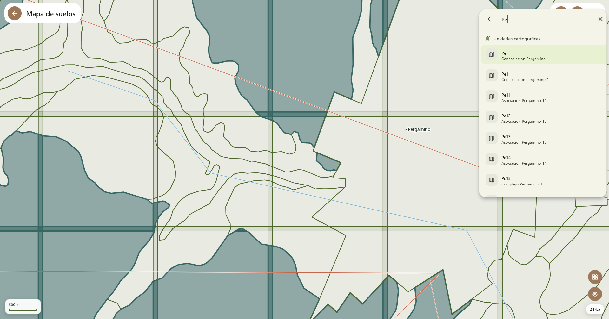
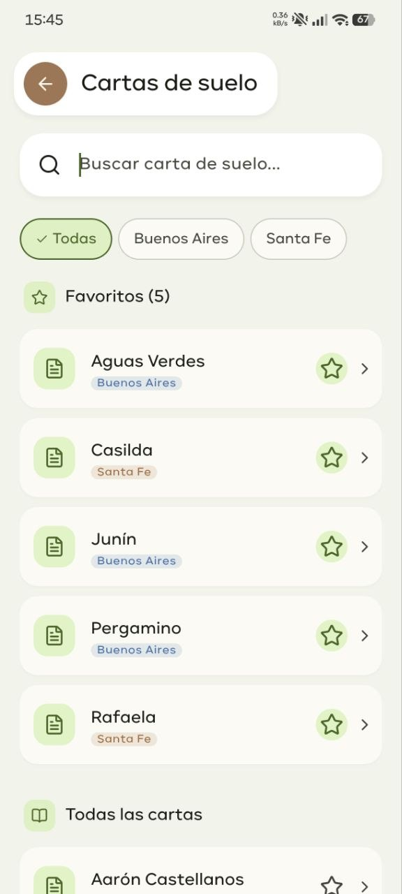

# SuelosAR Website

The public website for **SuelosAR**, an independent GIS application for Android and Windows that makes soil cartography easier to consult in the field. The current catalog covers Buenos Aires and Santa Fe Provinces, Argentina, using information from official INTA publications. SuelosAR is independent and is not affiliated with or endorsed by INTA.

**Live site:** [web-suelos-ar.vercel.app](https://web-suelos-ar.vercel.app)

**Application releases:** [GitHub Releases](https://github.com/eljerexd/suelosar/releases)

## SuelosAR in the field

The website presents the application on Windows and Android, plus provincial pages describing the available soil cartography.

| SuelosAR for Windows | SuelosAR for Android |
| --- | --- |
|  |  |

## Website features

- Provincial soil-map catalog for Buenos Aires and Santa Fe.
- Province-specific pages explaining coverage, source material and how to consult the cartography.
- Product tour and screenshots of the Android and Windows applications.
- Spanish (Argentina) and English interface, with light and dark themes.
- Direct links to the latest Android and Windows releases when available.
- Privacy, terms, disclaimer and data-source information.

## Requirements

- Node.js 20.9 or newer
- npm 10 or newer
- Visual Studio Code (recommended)

## Run locally

Open this folder in Visual Studio Code, open the integrated terminal, and run:

```bash
npm install
npm run dev
```

Then open [http://localhost:3000](http://localhost:3000).

No environment variables, external services, database, deployment account, or additional setup are required.

## Commands

```bash
npm run dev      # Start the development server
npm run build    # Create a production build
npm run start    # Run the production build
npm run lint     # Run ESLint
npm test         # Run project structure tests
```

## Project structure

```text
app/          Next.js routes, legal pages, metadata, and global CSS
components/   Reusable product, layout, legal, i18n, and theme components
lib/          Shared configuration, downloads, translations, and metadata
public/       Static files
styles/       Design tokens for color and typography
tests/        Lightweight project tests
```

## Technology

- Next.js App Router and TypeScript
- React, Tailwind CSS, Framer Motion and Lucide React
- Vercel Analytics and Speed Insights

## Coverage and data

The catalog currently lists Buenos Aires and Santa Fe as available provinces. Córdoba is shown as in preparation and does not link to a published page. Cartographic information belongs to its respective source organizations; consult [Data Sources](https://web-suelos-ar.vercel.app/data-sources) for details. The website and app do not imply institutional affiliation with INTA.

## Contributing

This repository contains the SuelosAR public website. For application releases, use the [SuelosAR releases page](https://github.com/eljerexd/suelosar/releases). Before proposing website changes, run the checks in [Commands](#commands).
